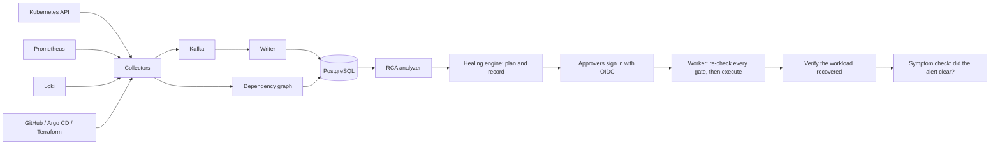

# Chronicle

Chronicle is an incident-analysis and guarded self-healing system for
Kubernetes. It records every change and failure across a cluster, can rebuild
what the cluster looked like at any past moment, works out why an incident
happened, and proposes a fix. A fix is carried out only after people approve it,
and only once every safety gate still passes at the moment it runs.

Three ideas run through the design:

* **Explainable, not guessed.** Root-cause analysis is deterministic. Every
  score comes with the factors that produced it, and an optional LLM only
  narrates a ranking that has already been made; it never introduces a cause.
* **Default-deny healing.** Chronicle plans and records decisions long before it
  is allowed to act. Acting needs an explicit switch, a dry-run observation
  period, a track record of being right, an allowlist, and human approval.
* **Measured, not claimed.** Accuracy and safety are backed by benchmarks, live
  fault injection on a real cluster, and tests that fail if a safeguard is
  removed. What has not been measured is listed as such.

> **Status (October 2026).** Chronicle works end to end on a local kind cluster,
> including live, approval-gated healing in a disposable test environment. It
> is ready to run as a **dry-run** advisor on a real cluster. It is **not** ready
> to execute healing actions in production: that is gated, by design, on 30 days
> of dry-run observation and a judged track record that no real cluster has
> produced yet. See [Status and limitations](#status-and-limitations).

---

## How an incident moves through Chronicle



1. **Collect.** Collectors turn cluster changes (deploys, config and resource
   changes, scales), failures (pods becoming unready, crash loops, OOM kills),
   metric alerts and error logs into one event schema.
2. **Map dependencies.** A versioned dependency graph is built from Kubernetes
   topology, references between objects and Linkerd service-mesh traffic, so the
   graph *as it was at the time* of an incident can be queried later.
3. **Diagnose.** For a symptom, the analyzer gathers events on entities upstream
   of it in the graph, scores them, and returns a verdict with a confidence.
4. **Plan.** The healing engine maps the leading cause to at most one action per
   outage, checks its preconditions, and records a proposal (or a refusal, with
   the reason). Nothing is executed at this stage.
5. **Approve.** People sign in with an OIDC identity provider and approve or deny.
   Broad actions need two different people.
6. **Execute.** A worker on the leader replica re-checks every gate against the
   present, claims the action atomically, and calls Kubernetes.
7. **Verify.** The action succeeds only when the workload is whole again (every
   replica updated, ready and available).
8. **Check the symptom.** The original alert must start clearing within 2
   minutes and stay clear for 5. A failure notifies Slack; a critical one in
   production pages.

The full design, with the reasons each tool was kept, replaced or added, is in
[docs/architecture.md](docs/architecture.md).

---

## Root-cause analysis

The analyzer (`internal/rca`) ranks every event in a symptom's lookback window
that sits upstream of it in the dependency graph. A candidate's score is a
product of factors, each visible in the API response:

* **event type** (a deploy weighs more than a log line),
* **time distance** to the symptom (with exponential decay across the window),
* **graph distance** (hops upstream),
* **blast radius** (how many services depend on it),
* and adjustments such as "this change undid an earlier one" or "this entity had
  already recovered".

The result is one of four verdicts: **root cause**, **ambiguous** (several causes
about equally plausible, all named), **inconclusive** (too weak to act on), or
**no root cause**. Healing never acts on anything but a confident root cause.

**Measured accuracy** (synthetic, controlled incidents with a known injected
cause; written by the same people who wrote the analyzer, so not production
accuracy):

| Benchmark | Incidents | Result |
|---|---|---|
| Development set | 85 | Top-1 100% (from 74% on the original analyzer) |
| Held-out set (a different application) | 66 | Top-1 98% (from 72%) |
| Independent final set | 117 | Inside the documented contract: Top-1 76/78, Top-3 78/78. All 117, latest run: Top-1 78/84 single-cause, Top-3 80/84, no false confident diagnoses |

The independent set was first run once, untouched; later reruns after general
fixes are labelled "post-fix" in
[internal/rca/benchdata/INDEPENDENT.md](internal/rca/benchdata/INDEPENDENT.md),
and it is never used for tuning. On real faults injected into a running cluster
(the chaos harness), RCA ranked the true cause first in all 8 experiments of the
final healing campaign.

---

## Healing

### What Chronicle can do

| Rule | Cause | Action | Confidence floor | Approvers |
|---|---|---|---|---|
| `restore-scaled-down-workload` | a workload scaled to zero | restore its replica count | 0.65 | 1 |
| `rollback-bad-deploy` | a bad release | roll back to an exact earlier pod template | 0.90 | 2 |
| `revert-bad-config` | a bad env or config change on a Deployment | roll back to an exact earlier pod template | 0.90 | 2 |
| `bump-memory-on-oom` | an OOM kill | raise the memory limit, capped at twice the original | 0.85 | 2 |
| `restart-deadlocked-pod` | a pod stuck unready | evict it (PodDisruptionBudgets apply) | 0.80 | 1, and **proposal-only** until enabled |

Rollbacks name the exact revision by a hash of the whole pod template, and
return only to a revision Chronicle has seen run healthily (an older one if the
previous was not).

**GitOps-managed workloads are remediated in Git.** For a workload that Argo CD
or Flux manages, Chronicle never writes to the cluster: its remedy is a
`git_revert`, a pull request that restores the application's files to the last
revision that ran healthily. One approver in Chronicle opens it; a reviewer merges
it in Git; the controller syncs it; Chronicle then checks the symptom cleared.
It never pushes to the branch the controller watches, and refuses if the files
changed in Git since the bad release. Workloads run by Argo Rollouts or Flagger are
left to those controllers.
ConfigMap and Secret contents are never reverted: Chronicle does not read them.
A workload annotated `chronicle.io/maintenance` is not restored.

### Safety gates

Every one of these must hold, re-checked at the moment of execution:

* `HEAL_LIVE_ENABLED=true` and `HEAL_KILL_SWITCH=false` (the defaults are the opposite)
* a 30-day dry-run observation period has passed
* enough past decisions have a judged outcome: 20 decisive and 80% right by
  default, **overall and for this action type on its own**
* the action type, namespace and workload are allowlisted
* the confidence clears the rule's floor; per-rule and global hourly caps and a
  30-minute per-workload cooldown hold
* the required approvers have approved within the 30-minute deadline, each with
  an OIDC sign-in under 5 minutes old, and each still permitted today
* the target still matches the evidence (a newer deploy, a paused rollout or a
  pod that recovered is a refusal, not a guess)

Every decision, including every refusal and its reason, is written to the
database before anything happens. Approval only records a decision; a separate
worker on the leader executes. Kyverno policies (in Audit mode) add an
admission-level backstop, and Chronicle's RBAC is namespaced and has no access
to Secrets. Details: [internal/heal/README.md](internal/heal/README.md).

### Verified live

On a disposable kind cluster, with Keycloak as the identity provider and real
faults injected by the chaos harness: restore and exact-revision rollback
succeeded and cleared the outage; a config typo was reverted and the symptom
check confirmed the alert stayed clear; denial, the cooldown, and refusal of
stale evidence all held; a restore that could not work under a pod quota was
recorded as failed; requests without a token got 401 and a non-approver 403
every time.

---

## Production readiness

* **Telemetry.** Chronicle serves Prometheus metrics on `:9102` (event pipeline
  lag, analysis time, approval-to-execution time, symptom-check verdicts, graph
  sync, leadership) plus `/healthz` and `/readyz`. `deploy/monitoring` ships a
  ServiceMonitor and eight SLO alerts.
* **High availability.** Two replicas; a Kubernetes Lease elects one leader for
  the singleton work. Executions are fenced in PostgreSQL, and events are
  de-duplicated in the database, so a leader overlap cannot double-act or
  double-count.
* **Failure drills.** The leader was force-deleted, killed and frozen past its
  lease; PostgreSQL, Kafka, Redis, Prometheus and Loki were each taken away for
  a minute. No event was lost, and the hangs those drills uncovered were fixed.
* **Scale (simulated with KWOK).** At 6,000 pods on 100 nodes: 566 MiB, analysis
  p99 of 2.1 s, every event stored within 2 s of being emitted.
* **Secrets.** External Secrets Operator fills the Kubernetes Secrets Chronicle
  reads, and Reloader restarts it when they rotate (about 30 s, tested on kind).
  An AWS Secrets Manager setup is written for EKS.
* **Start-up refusals.** In production Chronicle refuses to start without an API
  token, without a real database URL, or with live healing but no OIDC.

The measurements, drills and open items are in
[docs/production-readiness.md](docs/production-readiness.md); deploying to a real
cluster with GitOps is in [docs/deployment.md](docs/deployment.md).

---

## Running it locally

Requires Docker (8 GB is enough), `kind`, `kubectl`, `helm`, the Linkerd CLI and
Go 1.26. Everything runs in a local kind cluster named `chronicle`.

```bash
make setup             # kind cluster, Prometheus, Loki, Kafka, PostgreSQL, Redis, Linkerd
make deploy-victim     # a deliberately fragile demo app (frontend, api, worker, redis, postgres)
make deploy-chronicle  # build Chronicle, apply migrations, roll it out (dry-run)
kubectl --context kind-chronicle -n chronicle port-forward svc/chronicle 8181:8181
```

Then open <http://localhost:8181>. Break something
(`kubectl --context kind-chronicle scale deploy/redis --replicas=0`), pick the
alert in the console and run the analysis.

To try live, approval-gated healing with a real identity provider, use the
disposable end-to-end environment described in
[deploy/e2e/README.md](deploy/e2e/README.md) (`scripts/e2e-setup.sh`, then
`scripts/e2e-heal.sh`). Every cluster-changing script refuses any kube context
that is not a local `kind-*` cluster.

## Configuration

Copy `.env.example` to `.env`; it lists every variable the code reads, with the
default value and when to change it (a test fails if the two drift apart). The
ones that matter most:

| Variable | Purpose |
|---|---|
| `POSTGRES_URL` | The database. Required in a cluster and in production. |
| `CHRONICLE_API_TOKEN` | Bearer token for `/api/*`. Required in production. |
| `OIDC_ISSUER_URL`, `OIDC_CLIENT_ID`, `OIDC_ALLOWED_GROUPS` | Approver sign-in. Required for live healing in production. |
| `HEAL_LIVE_ENABLED`, `HEAL_KILL_SWITCH`, `HEAL_ALLOWED_*` | The master switches and allowlists for healing. |
| `HEAL_TWO_APPROVER_ACTIONS` | Action types that need two approvers. |
| `KAFKA_BROKERS`, `REDIS_ADDR`, `LOKI_URL`, `PROMETHEUS_URL` | Data sources and buffers; Kafka and Redis are optional. |
| `RCA_API_KEY` | Optional LLM narrator (any OpenAI-compatible endpoint); without it the narrative is deterministic. |
| `SLACK_WEBHOOK_URL`, `CHRONICLE_PUBLIC_URL` | Notifications, with a link back to the console. |
| `CHRONICLE_ENVIRONMENT` | `production` turns on the start-up refusals and paging. |

## API

| Endpoint | Purpose |
|---|---|
| `GET /api/events?from=&to=` | Recorded events in a time window |
| `GET /api/replay?t=` | The exact cluster state at a past instant |
| `GET /api/graph?at=` | The dependency graph, now or at a past instant |
| `GET /api/posture` | Live Kubernetes health of every resource |
| `POST /api/analyze?event_id=` | Root-cause analysis for a symptom, and the healing decision it leads to |
| `GET /api/heal/actions` | Every healing decision and its state |
| `POST /api/heal/actions/{id}/approve` · `/deny` | Decide a proposal, as a signed-in approver |
| `GET /api/heal/rules` | The rules and safety settings actually in force |
| `GET /api/heal/calibration` | How past decisions turned out, by action type and confidence |
| `GET /api/auth/config`, `/api/auth/me` | Sign-in configuration and the current identity |
| `GET /healthz`, `/readyz`; `:9102/metrics` | Liveness, readiness, Prometheus metrics |

## Repository layout

| Path | Contents |
|---|---|
| `cmd/collector` | The Chronicle server: collectors, API, console, healing worker |
| `cmd/chaos` | The fault-injection harness |
| `internal/collect`, `internal/event` | Collectors and the event schema |
| `internal/graph`, `internal/store`, `internal/replay` | Dependency graph, storage, point-in-time replay |
| `internal/rca` | Root-cause analysis and its benchmarks (`benchdata`) |
| `internal/heal`, `internal/revision` | Healing engine, executor, approvals, symptom checks |
| `internal/api`, `internal/auth`, `internal/web` | HTTP API, OIDC verification, console |
| `internal/metrics`, `internal/startup` | Telemetry and start-up safety checks |
| `internal/chaos` | Experiment catalog and scoring |
| `migrations` | PostgreSQL schema, applied in order at every start |
| `deploy` | Kubernetes manifests: base, healing executor RBAC, Kyverno, monitoring, secrets, e2e |
| `victim` | The demo application Chronicle watches |
| `scripts` | Setup, deployment, drills and test helpers |

## Tests

```bash
go test ./...                                   # unit tests
CHRONICLE_TEST_POSTGRES_URL=postgres://... go test ./internal/heal ./internal/rca ./internal/store
make rca-benchmark                              # RCA benchmarks (development and held-out sets)
make kyverno-test                               # admission policies
HEAL_TEST_KUBE_CONTEXT=kind-kyverno-test go test ./internal/heal -run RealCluster   # against a real API server
```

The live suites (the chaos campaign, failure drills and KWOK scale runs) are
heavy: they need the kind clusters and can saturate a laptop's Docker. Run them
deliberately; see [internal/chaos/README.md](internal/chaos/README.md) and
[docs/production-readiness.md](docs/production-readiness.md).

---

## Status and limitations

**Works and verified:** collection, the versioned graph, replay, RCA (measured on
benchmarks and live faults), healing proposals with every refusal recorded, OIDC
approval, live restore and rollback with recovery and symptom checks on a kind
cluster, Git-based remediation of an Argo CD workload end to end (bad commit,
diagnosis, approval, pull request, merge, sync, recovery), failure drills,
simulated scale, and secret rotation on kind.

**Built and tested, but never run live:** the per-action evidence gate, the
memory-bump cap, the maintenance annotation, restart eligibility, and Git-based
remediation for Flux, GitHub and Forgejo (Argo CD with Gitea is verified).

**Not done or not proven:**

* No real cluster has produced the 30 days of observation and the judged
  outcomes that live healing requires, so every confidence floor is still
  provisional.
* Restarts are unreachable from RCA in practice: a deadlocked pod scores about
  0.36 against a 0.80 floor. The floor was deliberately not lowered.
* Not tested against real Argo Rollouts or Flagger installations, AWS Secrets
  Manager, a production identity provider, or a multi-node production-like
  cluster (node loss, partitions, managed-database failover). No soak test.
* Rules exist only for scales, deploys, config changes and OOM kills; service,
  node and autoscaler causes are diagnosed but have no remedy.

Open items in detail: [internal/heal/README.md](internal/heal/README.md)
("Tracked work") and [docs/production-readiness.md](docs/production-readiness.md)
("Open").

## Documentation

| Document | What it covers |
|---|---|
| [docs/architecture.md](docs/architecture.md) | The signal-to-remediation path and the tool choices |
| [internal/heal/README.md](internal/heal/README.md) | Healing safety, configuration, review findings, every hardening round |
| [docs/production-readiness.md](docs/production-readiness.md) | SLOs, failure drills, scale, open items |
| [docs/deployment.md](docs/deployment.md) | Deploying to a real cluster with GitOps, in dry-run |
| [internal/rca/benchdata/README.md](internal/rca/benchdata/README.md) | How RCA accuracy is measured |
| [internal/chaos/README.md](internal/chaos/README.md) | The fault-injection harness |
| [deploy/e2e/README.md](deploy/e2e/README.md) | The disposable live-healing environment |
| [deploy/secrets/README.md](deploy/secrets/README.md) | External secrets and rotation |

## License

MIT — see [LICENSE](LICENSE).
