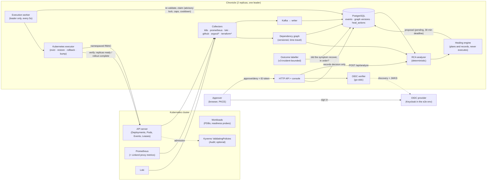

# Chronicle architecture: from signal to remediation

This is the current shape of the system after the RCA and healing hardening
rounds. `internal/heal/README.md` holds the healing safety details and
`internal/chaos/README.md` the fault-injection harness.

## Diagram

`*` Optional collectors. When Argo CD is configured, its Application list decides
which workloads are GitOps-managed (Chronicle then proposes a Git revert and never
writes).

## The path of one incident

1. **Collect.** Collectors turn cluster changes, failures and metric alerts into
   events and maintain a versioned dependency graph (Service → Pod, mesh
   edges from Linkerd, Argo CD Applications).
2. **Diagnose.** For an alert, the analyzer gathers events in a lookback window
   on entities upstream of the symptom in the graph *as it was at the time*,
   scores each, and returns a verdict with a confidence (below).
3. **Plan.** The engine maps the leading cause to at most one action per outage
   using rules (cause type → action, confidence floor, hourly cap), checks the
   action's preconditions and GitOps ownership, and records a proposal that
   names its evidence. A rollback names an exact pod-template revision, chosen
   from Chronicle's own history as one that ran healthily (an older one if the
   previous did not), and is never proposed against a workload that Argo Rollouts
   or Flagger manages. ConfigMap and Secret contents are never reverted, and a
   workload marked `chronicle.io/maintenance` is not restored. The proposal waits
   for approval with a 30-minute deadline; below the floor it is recorded as
   `blocked`, with the reason.
4. **Approve.** A person signs in with the OIDC provider in the console; the
   approve request carries the ID token. Chronicle verifies it (signature,
   issuer, audience, expiry, and a sign-in no older than 5 minutes) and requires
   membership of an approver group. The verified identity is what is recorded.
   Rollbacks and memory bumps need two *different* people: each approval is a row
   keyed by the person's identity, so a second click by the same person does not
   count, and one denial ends the decision. The shared token cannot approve these.
   Approval executes nothing.
5. **Execute.** The leader's worker re-checks everything against the present
   (deadline, current floor, preconditions, live/kill switch, observation period,
   the evidence gate overall *and* for this action type alone, allowlists, enough
   distinct approvers, each still on today's allowlist), then claims the action atomically under an
   advisory lock (per-rule and global hourly caps, per-workload cooldown, one
   execution per outage) and calls the executor. A restart is held back, still
   approved and claiming nothing, until the pod has been unready for 5 minutes
   with no container restart in the last 10 (and is not mid-rollout); restarts
   are proposal-only unless `HEAL_RESTART_EXECUTION_ENABLED` is set.
6. **Verify.** The executor re-reads the target before writing, then waits for
   real recovery: every replica updated, ready and available. A rollout the
   Deployment controller declares failed (`ProgressDeadlineExceeded`, or a
   `ReplicaFailure` that stops replicas being created) fails at once. Restarts
   use the Eviction API, so PodDisruptionBudgets apply.
7. **Check the symptom.** Verifying the workload is not verifying the alert.
   After a successful action Chronicle re-measures the original alert with the
   collector's own expression and threshold: it must start clearing within 2
   minutes and stay clear for 5. The verdict is succeeded, failed or unknown
   (no data is never recovery). A failure notifies Slack; only a critical
   symptom in production pages. Nothing is reverted automatically, and the
   result never counts as evidence for the confidence gates.
8. **Judge.** The outcome labeller later checks whether the original symptom
   recovered after the action, within that incident, and records
   `confirmed`, `contradicted` or `unknown`. Those labels feed the evidence
   gate that must be passed before live healing is allowed.

## Components kept, replaced or added

| Concern | Choice | Why |
|---|---|---|
| RCA | **Kept, custom** | Deterministic, explainable, measured on frozen benchmarks; no off-the-shelf tool does change-aware, topology-aware ranking over this event model |
| Approver identity | **OIDC via `go-oidc`; Keycloak in the test env** | Standard, provider-agnostic; replaced a shared token and a self-declared name |
| Two-person rule | **Approval rows in PostgreSQL**, counted under a row lock | Distinct people, not distinct clicks; two people approving at once are both counted; no extra service |
| Restart | **Kubernetes Eviction API** (was a raw delete) | Honours PodDisruptionBudgets; `unhealthyPodEvictionPolicy: AlwaysAllow` lets a deadlocked pod go |
| Rollback target | **Whole-pod-template hash** (`internal/revision`), judged against recorded failures | The image alone cannot see an env, sidecar or limit change; "the previous revision" is not evidence that it was healthy |
| Recovery check | **Kubernetes readiness and rollout status** (was "change accepted"), then a **symptom check** on the alert's own Prometheus expression | The workload must be whole, and the alert must actually clear |
| Durable execution | **Kept: Postgres-backed worker** (Temporal rejected) | Single-step actions; the state machine and claims already live in Postgres |
| Policy backstop | **Kept: Kyverno, Audit** | Defence in depth at admission; now also covers `pods/eviction` |
| Secrets | **External Secrets Operator** filling the same Kubernetes Secrets, with **Reloader** to roll pods on a change; backend per environment (AWS Secrets Manager on EKS, OpenBao for self-hosting) | Chronicle needed no code change. Tested on kind with ESO's fake provider; the AWS backend is written and not run (`deploy/secrets/README.md`) |
| Telemetry | **Prometheus metrics of Chronicle's own** on `:9102`, SLO alerts in `deploy/monitoring` | The objectives in `docs/production-readiness.md` can only be held if they are measured |
| Fault injection | **Kept: custom harness**, extended with heal mode (LitmusChaos/Chaos Mesh not adopted) | Most faults are spec changes those tools do not model; pre-registration, scoring and guaranteed restore are the harness's value |
| Alert source | **Kept: Prometheus** | Already the alert source; the symptom check re-reads the same expressions |
| Unsafe configuration | **Start-up refusals** (`internal/startup`) | In production Chronicle will not start without an API token, a real database URL, or OIDC when live healing is on |
